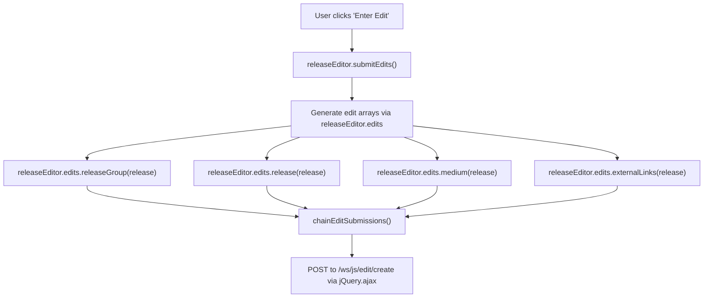
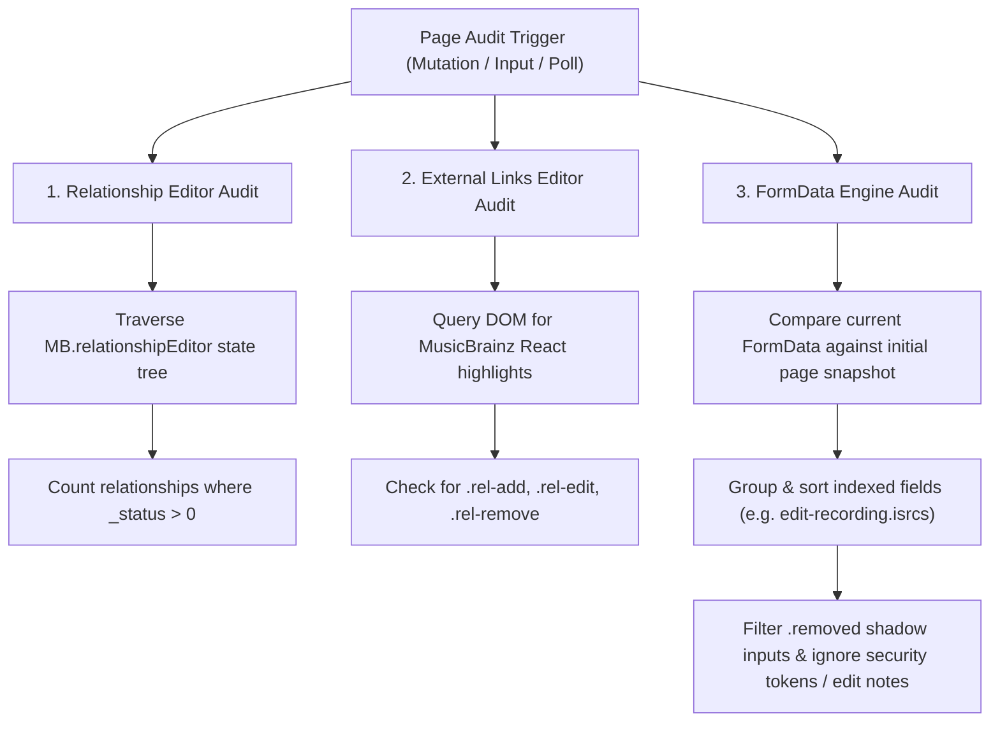

# MusicBrainz Architecture & Nuances

This file contains critical context for writing userscripts targeting MusicBrainz.org.

## 1. UI Architecture (Knockout.js vs DOM)

MusicBrainz heavily relies on **Knockout.js** and **React** for its modern UI components (especially the Release Editor).

* **Rule of Thumb**: When modifying data in the editor (like deduplicating "feat." artists), **prefer hooking into the Knockout viewmodels / observables** over raw DOM manipulation.
* **Why**: DOM manipulation (like dispatching click/input events) is fragile and prone to race conditions with React/Knockout render cycles. Reading and writing directly to observables (e.g., `artistCredit`) is significantly more efficient and robust.
* **Verification**: Always verify if the necessary observables are exposed to the `window` or accessible from the userscript context before proceeding.
* **Knockout Binding Context Fallback**: If a global viewmodel constructor (e.g., `MB.Art.UploadProcessViewModel`) is wrapped by the userscript but is sometimes instantiated before the script hooks it, you can retrieve the bound viewmodel directly from the DOM using `ko.dataFor(element)` (e.g., querying for a form or action button).

## 2. Source Code References

To avoid hallucinations about how a page works, check the actual MusicBrainz source code.

* **Main Repository**: [github.com/metabrainz/musicbrainz-server](https://github.com/metabrainz/musicbrainz-server)
* **Useful for**: Finding exactly which Knockout viewmodels are bound to specific elements, checking CSS classes, and understanding hidden form fields.
* **Release Merge Logic (`MusicBrainz::Server::Edit::Release::Merge`)**:
  * **Release Events**: When merging releases, release events (country + date pairs in `release_country` / `release_unknown`) from all source releases are combined into the target release. Distinct countries/dates between source and target releases do not overwrite or destroy each other; both are preserved post-merge (unless duplicate date/country combinations exist).
  * **Barcodes & Labels**: Conflicting barcodes/labels adhere to the surviving target release, while empty/unset fields on the source release simply adopt the target's values without clash.

## 3. API Documentation & Limits

If a userscript needs to fetch metadata, use the official API rather than scraping HTML whenever possible.

* **Documentation**: [MusicBrainz API Docs](https://musicbrainz.org/doc/MusicBrainz_API)
* **Rate Limits**: The API is strictly rate-limited to **1 request per second** per IP address. Your userscript **must** implement throttling/delays between requests, or the user's IP will be temporarily blocked (HTTP 503).
* **User-Agent**: Always provide a descriptive `User-Agent` string identifying your script and contact info, as per their guidelines.

### The Private JSON API (`/ws/js/`)

MusicBrainz serves its Knockout/React components using an internal, session-authenticated private JSON web service mounted under the `/ws/js/` path.

* **Key Endpoints & Query Syntaxes**:
  * **Entity Detail Query (`/ws/js/entity/<mbid>`)**:
    * **URL Format**: `/ws/js/entity/<mbid>?inc=rels`
    * **Description**: Returns database `id`, `gid`, `name`, `sort_name`, `comment`, `entityType`, and when `?inc=rels` is passed, a flat `relationships: [...]` array containing relationship objects (`id`, `linkTypeID`, `target_type`, `target`, `attributes`, `backward`, `begin_date`, `end_date`, `verbosePhrase`).
  * **Type Info Query (`/ws/js/type-info/<typeName>`)**:
    * **URL Format**: `/ws/js/type-info/link_type` (also supports `link_attribute_type`, `language`, `series_type`, `work_type`).
    * **Description**: Returns JSON dictionary `{ "link_type_list": [...] }` containing all MusicBrainz relationship types with `id`, `gid`, `name`, `entityType`, `type0`, `type1`, `link_phrase`, `reverse_link_phrase`, `long_link_phrase`, `description`, `deprecated`, `attributes`.
  * **Autocomplete Search (`/ws/js/<entityType>?q=<query>`)**:
    * **URL Format**: `/ws/js/<entityType>?q=<query>` (e.g. `/ws/js/artist?q=Nirvana`, `/ws/js/label?q=Sub+Pop`).
    * **Description**: Returns array of entity objects containing `id`, `gid`, `name`, `sort_name`, `comment`, `entityType`, `primaryAlias`, and a trailing `{ current, pages }` pagination object.
  * **Release Data Fetch**: `/ws/js/release/<gid>`
  * **Medium & Track Fetch**: `/ws/js/medium/<mediumId>` and `/ws/js/tracks/<mediumId>?page=<page>`
  * **Edit Operations**: `/ws/js/edit/preview` and `/ws/js/edit/create` (For staging previews or submitting edits programmatically).
* **Nuances for Userscripts & Web Tools**:
  * **Session-backed**: Requests inherit the active browser cookies (meaning userscripts can make changes on behalf of the logged-in user).
  * **Lightweight & Pre-parsed**: Tailored to the database schemas and views directly mapped by the frontend models, avoiding XML-to-JSON parsing overhead.

## 4. Search Syntax

MusicBrainz uses Lucene search syntax for its advanced queries.

* **Documentation**: [MusicBrainz Search Syntax](https://musicbrainz.org/doc/Search)
* **Usage**: When building search URLs dynamically in a userscript (e.g., finding releases by a specific label), encode the parameters using the proper Lucene field names (like `arid:` for Artist ID, `reid:` for Release ID).

## 5. URL Relationships (`link_type`)

When building scripts that seed or submit external URLs to MusicBrainz (e.g., from Harmony or other external sites), passing raw URLs is insufficient.

* **The Nuance**: MusicBrainz categorizes all external URLs using a specific relationship type, internally represented as a `link_type` (e.g., streaming, digital download, official homepage).
* **Requirement**: Seeding and submission scripts must explicitly map and pass the correct `link_type` ID alongside the `url` to ensure the edits are correctly formatted and categorized in the MusicBrainz database.

## 6. Release Editor (Knockout.js Observables)

The Release Editor exposes a complex nested Knockout viewmodel under `window.MB.releaseEditor` (usually accessed via `unsafeWindow.MB.releaseEditor`).

* **Root Access**: `window.MB.releaseEditor.rootField.release()`
* **Dumping the Model Tree**: You can extract the full structure at any point via serializing `release()`.

### Detailed Model Structures

#### Release Model (`Release`)

* `gid`: Observable string matching the release MBID (if the release exists).
* `name`: Observable string containing the release title.
* `comment`: Observable string containing release disambiguation text.
* `annotation`: Observable string containing annotation notes.
* `statusID`, `languageID`, `scriptID`, `packagingID`: Observables representing standard category configurations.
* `artistCredit`: Observable holding the release artist credit object.
* `events`: `observableArray` of `ReleaseEvent` models.
* `labels`: `observableArray` of `ReleaseLabel` models.
* `mediums`: `observableArray` of `Medium` models.
* `releaseGroup`: Observable of `ReleaseGroup` model.

#### Language and Script Database Schemas & Seeding Standards

Confirmed from `musicbrainz-server` database definitions (`admin/sql/CreateTables.sql`):

* **Language Table (`language`)**:
  * `id`: Integer primary key (e.g., `76` for Chinese, `120` for English).
  * `iso_code_3`: 3-character ISO 639-3 code (e.g., `'zho'` for Chinese, `'eng'`, `'jpn'`, `'zxx'`).
  * `iso_code_1`: 2-character ISO 639-1 code (e.g., `'zh'`, `'en'`, `'ja'`).
* **Script Table (`script`)**:
  * `id`: Integer primary key.
  * `iso_code`: 4-character ISO 15924 script code (e.g., `'Hant'` for Traditional Han, `'Hans'` for Simplified Han, `'Latn'` for Latin, `'Cyrl'` for Cyrillic).
* **Seeding & Harmony Representation**:
  * Seeding payloads pass 3-letter ISO 639-3 codes for language (`{ language: { code: 'zho' } }`) and 4-letter ISO 15924 codes for script (`{ script: { code: 'Hant' } }` or `{ script: { code: 'Hans' } }`).

#### Medium Model (`Medium`)

* `name`: Observable string for the disc or medium title (optional).
* `position`: Observable integer representing the medium's index (1-indexed).
* `formatID`: Observable format ID (e.g. CD, Vinyl, Digital).
* `tracks`: `observableArray` of `Track` models.

#### Track Model (`Track`)

* `id`: Database row ID integer (if the track was pre-existing in the DB).
* `gid`: Track MBID string.
* `name`: Observable string for the track title.
* `length`: Observable integer representing duration in milliseconds.
* `formattedLength`: Observable string representing duration (e.g. `4:12`).
* `position`: Observable integer representing track position index (1-indexed).
* `number`: Observable string representing track number prefix (e.g., `A1`, `1`).
* `isDataTrack`: Observable boolean flag.
* `artistCredit`: Observable holding the track-level artist credit object.

#### Artist Credit Sub-structure

The `.artistCredit()` observable on both `Release` and `Track` contains:

```javascript
{
    names: [
        {
            name: "Credited Artist Name", // string
            joinPhrase: " & ",           // string
            artist: {                    // Database entity object (or empty placeholder)
                id: 12345,               // Numeric database ID
                gid: "mbid-guid-...",    // MBID string
                name: "Artist Name",     // Canonical name string
                sort_name: "Sort Name",  // Sort name string
                entityType: "artist"     // Always "artist"
            }
        }
    ]
}
```

*Note: In URLs or seeded pages, unlinked placeholders might contain empty strings for `id`, `gid`, `name`, and `sort_name`. Use check `(artist.id || artist.gid)` to verify if it is linked to a real DB entity.*

* **Track Operations**: Move or delete tracks by invoking editor operations directly, e.g., `MB.releaseEditor.moveTrackUp(trackIndex)`, `MB.releaseEditor.moveTrackDown(trackIndex)`, or `MB.releaseEditor.removeTrack(trackIndex)`.
* **Unformatting Length**: Parse duration string to milliseconds using `MB.releaseEditor.utils.unformatTrackLength('3:53')`.

#### References & Source Files

To verify or update the schema when the server architecture evolves, refer to the following source files in the `musicbrainz-server` repository:

* **Release, Medium, Track fields & Knockout models**: [`root/static/scripts/release-editor/fields.js`](https://github.com/metabrainz/musicbrainz-server/blob/master/root/static/scripts/release-editor/fields.js)
* **Base entity class schemas**: [`root/static/scripts/common/entity.js`](https://github.com/metabrainz/musicbrainz-server/blob/master/root/static/scripts/common/entity.js)

## 7. Relationship Editor (React / Redux Action Dispatcher)

The Relationship Editor relies on React/Redux-like dispatchers. Instead of interacting with the DOM, dispatch relationship additions or updates directly into the reducer.

* **Source References**:
  * `root/static/scripts/relationship-editor/components/RelationshipEditor.js` (Binds `MB.relationshipEditor.dispatch`, `MB.relationshipEditor.state`, `MB.relationshipEditor.getRelationshipStateId`, `MB.tree`).
  * `root/static/scripts/relationship-editor/types/actions.js` (Defines `update-relationship-state` action type schema).
  * `root/static/scripts/relationship-editor/utility/getRelationshipStateId.js` (Generates relationship state IDs).
  * `root/static/scripts/relationship-editor/components/RelationshipDialogContent.js` (Binds `MB.relationshipEditor.relationshipDialogDispatch`).
* **Mount Waiting**: Wait/poll for `window.MB.relationshipEditor.state.entity` to be populated.
* **Dispatching Relationships**: Call `window.MB.relationshipEditor.dispatch()` with:

  ```javascript
  window.MB.relationshipEditor.dispatch({
      type: 'update-relationship-state',
      sourceEntity,
      batchSelectionCount: null,
      creditsToChangeForSource: '',
      creditsToChangeForTarget: '',
      oldRelationshipState: null,
      newRelationshipState: {
          _lineage: [],
          _original: null,
          _status: 1, // 1 = added this session, 2 = removed, 3 = edited
          attributes: attributesTree || null,
          begin_date: null,
          editsPending: false,
          end_date: null,
          ended: false,
          entity0: e0, // sorted alphabetically by entityType
          entity0_credit: e0_credit || '',
          entity1: e1,
          entity1_credit: e1_credit || '',
          id: window.MB.relationshipEditor.getRelationshipStateId(),
          linkOrder: 0,
          linkTypeID: linkTypeID,
      },
  });
  ```

* **Attributes Tree**: Build target attributes using `window.MB.tree.fromDistinctAscArray(sortedAttributeObjs)`.

## 8. Safe Inputs (React/Knockout Undo-Safe Text Updates)

Modifying form fields directly via `textarea.value = ...` breaks the frontend framework's binding and clears browser undo/redo history.

* **The Pattern**: Prefer updating via the native input pipeline (execCommand) to preserve undo/redo state (`Ctrl+Z`), falling back to custom event dispatchers.

  ```javascript
  function setInputValue(element, value) {
      let ok = false;
      try {
          element.focus();
          element.setSelectionRange(0, element.value.length);
          ok = value ? document.execCommand('insertText', false, value)
                     : document.execCommand('delete', false, null);
          if (ok && element.value !== value) ok = false;
      } catch (e) { ok = false; }
      if (!ok) {
          const descriptor = Object.getOwnPropertyDescriptor(window.HTMLTextAreaElement.prototype, 'value')
              || Object.getOwnPropertyDescriptor(window.HTMLInputElement.prototype, 'value');
          descriptor.set.call(element, value);
          element.dispatchEvent(new Event('input', { bubbles: true }));
      }
      element.dispatchEvent(new Event('change', { bubbles: true }));
  }
  ```

## 9. React Hydration & Seeding Injection Detection

### A. React Hydration Detection (Event-driven Polling Alternative)

Instead of using MutationObservers or `setInterval` polling to wait for React components to finish rendering or hydrating on the page, use native MusicBrainz hydration events.

* **MBS Codebase Context**: In metabrainz/musicbrainz-server [Pull Request #2566](https://github.com/metabrainz/musicbrainz-server/pull/2566), a custom `'mb-hydration'` DOM event was introduced. When React hydrates a page section (e.g., Release Editor or merge pages), it fires this event.
* **The Pattern**: MusicBrainz fires an `mb-hydration` event when React finishes hydrating a DOM element. Hydration can also be checked synchronously by inspecting properties on the target element starting with `_reactListening` (standard React indicator for active root/listeners).

  ```javascript
  function onReactHydrated(element, callback) {
      const alreadyHydrated = Object.keys(element)
          .some((propertyName) => propertyName.startsWith('_reactListening') && element[propertyName]);

      if (alreadyHydrated) {
          callback();
      } else {
          element.addEventListener('mb-hydration', callback, { once: true });
      }
  }
  ```

  This is extremely clean, avoids fragile DOM state race conditions, and is natively supported by the MusicBrainz Server frontend hydration bridge.

### B. Seeding Injection Completion Detector & Multi-Phase Lifecycle

When external scripts (such as `MusicBrainz: Seed URLs to Release Recordings` by `rinsuki`) inject relationships via URL hash parameters (e.g. `#seed-urls-v1=...`), a multi-phase lifecycle ensures reliable execution in background tabs:

| # | Detection Method | Type | Relies on DOM? | Interoperable / Side-effect free? | Purpose |
| :-: | :--- | :--- | :-: | :-: | :--- |
| **1** | **URL Hash & Parameter Validation** | Synchronous | ❌ No | ✅ Yes | Detects & validates seeding JSON hash (`isValidSeedingHash`), handling browser hash truncation gracefully |
| **2** | **Capture-Phase Event Loop Yielding** | Event-driven | ❌ No | ✅ Yes | Yields thread via `setTimeout(0)` right after seed button click |
| **3** | **Native `mb-hydration` Event** | DOM Event | ❌ No | ✅ Yes | Signals when React component hydration completes |
| **4** | **Read-only Redux State Inspection** | Data Model | ❌ No | ✅ Yes | Iterates `MB.tree.iterate` checking for `rel._status > 0` (pending edits) |
| **5** | **Redux Dispatch Proxying** | Hook / Proxy | ❌ No | ⚠️ Mutates `dispatch` | Intercepts `update-relationship-state` actions |
| **6** | **DOM MutationObserver / Button Watcher** | DOM Mutation | Yes | ✅ Yes | Watches seed button text (`URLs seeded successfully`) and `disabled` status |

#### 3-Phase Seeding Lifecycle Workflow

1. **Phase 1 (Injection & Medium Expansion)**: Wait for the specific third-party seed button (`Seed URLs to Recordings`). If collapsed mediums exist, automatically click `Expand all mediums` to ensure all tracks load into Redux state before seeding.
2. **Phase 2 (Execution Tracking & Timeout Guard)**: Wait for the seed button to complete (`btn.disabled === true` or text `"URLs seeded successfully"`). Enforce a 15-second safety timeout fallback in case of unhandled seed script crashes (e.g., `SyntaxError` from truncated hashes).
3. **Phase 3 (Pending Edits Audit & No-Op Resolution)**: Inspect `window.MB.relationshipEditor.state` for pending edits (`_status > 0`). If edits exist, acquire submission lock. If 0 edits exist (all seeded URLs already present), close tab cleanly as a pre-submission no-op!

## 10. Standalone Entity Editing Context & Delegated Event Interception

On standalone edit pages (e.g., `/recording/create` or `/recording/*/edit`), UI flow and event bindings differ significantly from the nested Release Editor viewmodel.

* **Context Differences**:
  * `window.MB.releaseEditor` is `undefined`.
  * To access Knockout models programmatically, use `window.MB.getSourceEntityInstance()`. This returns the source entity instance cache containing observables (e.g. `artistCredit`).
* **Delegated Event Interception and Event Loop Timing Nuances**:
  * Natively, "Guess Feat." buttons on standalone pages are bound via delegated jQuery click handlers on the `document` object (e.g., `$(document).on('click', 'button.guessfeat.icon', ...)`).
  * Since these event listeners are defined within private module closures, they cannot be replaced directly. Instead, we listen in the **capture phase** (`addEventListener(..., true)`) to record state.
  * **The React/Knockout Synchronization Timing Bug**:
    1. The `#artist-credit-editor` is a **React component** (`KnockoutArtistCreditEditor` mapped in `root/static/scripts/edit/components/forms.js`) that synchronizes with the Knockout edit model by subscribing to the `artistCredit` observable.
    2. During capture phase execution, if we queue a microtask via `queueMicrotask`, it is placed at the front of the browser's microtask queue.
    3. The click event bubbles. Natively, jQuery's delegated click handler catches the event and invokes `guessFeat`, which updates the `artistCredit` Knockout observable synchronously.
    4. The Knockout observable's update triggers the React subscription handler, which dispatches a React state update. React batches this update and schedules a virtual DOM re-render asynchronously.
    5. Because our microtask was queued in the capture phase before the subscription fired, our microtask executes *before* React's render task commits changes to the DOM.
    6. As a result, when our code searches for newly added DOM elements (like hidden inputs `ac-source-artist-${index}`), they do not exist yet.
  * **The Solution**: Use a macrotask delay (`setTimeout(..., 100)`) in the click handler. This pauses execution and yields the thread, allowing React's asynchronous render cycle to fully complete and commit the new DOM nodes before the post-processing script runs.

  ```javascript
  document.addEventListener('click', (event) => {
      const button = event.target.closest('button.guessfeat');
      if (!button) return;

      const originalTitle = input.value;
      const originalArtists = getCurrentArtistNames(button);

      // Must use a macrotask timeout to allow Knockout rendering microtasks to complete and mount DOM inputs
      setTimeout(() => {
          removeArtistFromTitle(input, button, originalTitle, originalArtists);
      }, 100);
  }, true);
  ```

## 11. Native Guess Case & Guess Feat Mechanics

MusicBrainz implements native Guess Case and Guess Feat features inside `root/static/scripts/guess-case` and `root/static/scripts/edit/utility/guessFeat.js`.

* **Guess Case Formatting**:
  * Main module (`MB.GuessCase.Main`) tokenizes title strings (`GuessCaseInput`/`GuessCaseOutput`) and processes them via `utils/titleString.js`.
  * Uppercases roman numerals matching `/^m{0,4}(cm|cd|d?c{0,3})(xc|xl|l?x{0,3})(ix|iv|v?i{0,3})$/i` (except exclusions like `"mi"` or `"mix"`).
  * Forces defined lowercase words (like `a`, `an`, `the`, `to`, `de`, `di`, etc.) to lowercase unless positioned at the start of a title or bracket.
  * Normalizes vinyl sizes (`12''`/`12in` $\rightarrow$ `12"`) and trims whitespace around brackets during the preprocess step.
  * Uses underscore masking during processing to protect multi-word phrases (e.g. `a cappella` $\rightarrow$ `a_cappella`, `OC ReMix` $\rightarrow$ `oc_remix`), restoring proper case during postprocess.

* **Guess Feat Extraction**:
  * The native function `guessFeat(entity)` parses featured artists out of entity names (titles) via `extractFeatCredits`.
  * It tries to match parsed text names against the entity's linked `relatedArtists` (by GID/relationship similarity), strips the match from the name, and appends the new names to the `artistCredit` observable.
  * When the **Release Attributes** "Guess feat. artists" button is clicked, it runs `guessFeat` on the release itself. Knockout updates the release-level artist credit, which automatically propagates down to matching tracks via a subscription (`init.js` $\rightarrow$ `getUpdatedTrackArtists`).

## 12. Complete MusicBrainz Editing UI Architecture & Frontend API Reference

This section maps the complete frontend architecture of the MusicBrainz editing UI, detailing how data flows from URL seeding $\rightarrow$ Knockout/React UI state $\rightarrow$ `MBEdit` payloads $\rightarrow$ `/ws/js/edit/create` submission endpoints.

---

### A. The Global `window.MB` Namespace

The `window.MB` object is the root entrypoint initialized by `root/static/scripts/common/MB.js` and populated by module bundles.

| Symbol / Property | Path / Module | Purpose / Access Pattern |
| :--- | :--- | :--- |
| `window.MB.releaseEditor` | `release-editor/viewModel.js` | Main Knockout Release Editor viewmodel (`rootField`, `externalLinksData`, `edits`, etc.). |
| `window.MB.releaseEditor.edits` | `release-editor/edits.js` | Payload generators for release edits (release group, release, medium, recording, link rels). |
| `window.MB.relationshipEditor` | `relationship-editor/` | React/Redux Relationship Editor (`dispatch`, `state`, `getRelationshipStateId`). |
| `window.MB.getSourceEntityInstance` | `edit/` | Returns the Knockout model instance on standalone edit pages (`recording/create`, `artist/edit`). |
| `window.MB.entityCache` | `common/entity.js` | In-memory cache of parsed database entities indexed by MBID (`gid`). |
| `window.MB.tree` | `weight-balanced-tree` | Immutable weight-balanced binary tree helper for external link & attribute sets. |
| `window.MB.constants` | `common/constants.js` | Central repository of GIDs, Type IDs, and system constants. |
| `MBEdit` (Internal Module) | `edit/MB/edit.js` | Internal server bundle module (not exported directly on `window`, accessed via `MB.releaseEditor.edits`). |

---

### B. Core Constants, Type IDs & Attribute GIDs

* **Source References**:
  * `root/static/scripts/common/constants.js` (Frontend exports: `VIDEO_ATTRIBUTE_GID`, `VIDEO_ATTRIBUTE_ID`, `NOLABEL_GID`, `NOLABEL_ID`, `VARTIST_ID`, etc.).
  * `t/sql/initial.sql` (Backend database seed definitions for `link_type`, `link_attribute_type`, `artist`, `label`).

| Category | Constant / Attribute Name | GID / ID Value | Description / Usage |
| :--- | :--- | :--- | :--- |
| **URL Link Types** | Recording Streaming (`edit-recording.url.N.link_type_id`) | ID: `268`<br>(GID: `'7e41ef12-a124-4324-afdb-fdbae687a89c'`) | URL relationship for free recording streaming (YouTube, SoundCloud). |
| | Release Streaming (`urls.N.link_type`) | ID: `85`<br>(GID: `'08445ccf-7b99-4438-9f9a-fb9ac18099ee'`) | URL relationship for free release streaming. |
| | License (`urls.N.link_type`) | ID: `301` | URL relationship for Creative Commons or copyright license links. |
| | Official Homepage | ID: `76` | Main official artist/label website URL. |
| | Digital Media Purchase | ID: `75` | Digital download store URL (Bandcamp, iTunes). |
| **Attributes** | Video Attribute | GID: `'112054d5-e706-4dd8-99ea-09aabee36cd6'`<br>(ID: `582`) | Marks a recording or URL relationship as a video recording/stream. |
| **Entities** | No Label Placeholder | GID: `'157afde4-4bf5-4039-8ad2-5a15acc85176'`<br>(ID: `3267`) | Used when a release has no record label specified. |
| **Artist IDs** | Various Artists | ID: `1` (GID: `'89fd92c9-9402-41e9-9069-9f7fd862c943'`) | Standard VA credit placeholder. |

---

### C. Programmatic Read & Write Patterns

#### 1. Release Editor (`window.MB.releaseEditor`)

The Release Editor uses nested Knockout.js observables.

* **Reading Release Data**:

  ```javascript
  const editor = window.MB.releaseEditor;
  const release = typeof editor.rootField.release === 'function'
      ? editor.rootField.release()
      : editor.rootField.release;

  const releaseTitle = release.name(); // Read observable
  const mediumList = release.mediums(); // Array of Medium models
  ```

* **Writing Release Data**:
  * **Release Title**: `release.name("New Title");`
  * **Track Name**: `track.name("Track Title");`
  * **Track Duration**: `track.length(245000);` (in milliseconds)
  * **Track Recording Video Flag**:
    * Set `recVal.video = true` on `track.recordingValue()`.

#### 2. External Links Data Structure & Weight-Balanced Binary Tree

External links in the Release Editor are stored in a weight-balanced binary tree observable at `editor.externalLinksData()`.

* **Reading & Traversing Links**:

  ```javascript
  function extractTreeNodes(node) {
      if (!node) return [];
      const res = [];
      if (node.left) res.push(...extractTreeNodes(node.left));
      if (node.value) res.push(node.value);
      if (node.right) res.push(...extractTreeNodes(node.right));
      return res;
  }

  const linksData = window.MB.releaseEditor.externalLinksData();
  const links = extractTreeNodes(linksData);

  links.forEach(link => {
      console.log("URL:", link.url);
      link.relationships.forEach(rel => {
          console.log("Link Type ID:", rel.linkTypeID, "Video flag:", rel.video);
      });
  });

---
`

### D. Edit Payload Generation (`MB.releaseEditor.edits`) & Submission Lifecycle

When the user clicks **"Enter edit"**, `releaseEditor.submitEdits()` compiles individual edit objects via `releaseEditor.edits` and submits them in order to `/ws/js/edit/create`:



---

### E. Dry Run & Interception Patterns

To safely test, dump, or verify edit payloads without making persistent changes to MusicBrainz:

* **Patching `jQuery.ajax`**:

  ```javascript
  const $ = window.jQuery || window.$;
  const origAjax = $.ajax;
  $.ajax = function (options, ...args) {
      const url = typeof options === 'string' ? options : options?.url || '';
      if (window.__mbDryRun && (url.includes('/ws/js/edit/create') || url.includes('/ws/js/edit/preview'))) {
          let parsedData;
          try { parsedData = JSON.parse(options.data); } catch (e) { parsedData = options.data; }
          console.warn("[DRY RUN BLOCKED] Submission payload:", parsedData);

          const dfd = $.Deferred();
          const response = { edits: (parsedData?.edits || []).map(e => ({ response: 1, edit_id: 999999, edit: e })) };
          setTimeout(() => dfd.resolve(response, 'success', { status: 200 }), 50);
          return dfd.promise();
      }
      return origAjax.apply(this, [options, ...args]);
  };
  ```

---

### F. Seeding vs. Client-Side Hydration Schema Differences

| Target | Parameter Path | Correct Format / Type | Notes & Common Gotchas |
| :--- | :--- | :--- | :--- |
| **Release Seeding** | `artist_credit.names.0.mbid` | String (Artist GID) | **Must use `mbid`**, NOT `id`. Using `id` triggers `"Unknown field: artist_credit.names.0.artist.id"`. |
| | `artist_credit.names.0.artist.name` | String | Canonical artist name required when seeding artist MBID. |
| | `mediums.0.track.0.length` | Integer (ms) | Track duration in milliseconds. |
| | `urls.0.link_type` | String/Number (e.g. `'85'`) | Seeding supports URL link type ID, but **does NOT support seeding URL relationship attributes (like `video`)**. |
| **Client-side Hydration** | `track.recordingValue().video` | Boolean (`true`) | Must be set on hydration via `MusicBrainzReleaseAddPage`. |

---

### G. Relationship Editor Architecture (`React + Redux`)

* **Source Reference**: `root/static/scripts/relationship-editor/` (React components in `components/`, state reducers in `state.js`, actions in `actions.js`, binary tree utilities in `root/static/scripts/common/utility/tree.js`).

On release relationship editing pages (`/release/<mbid>/edit-relationships`), MusicBrainz uses a **React + Redux** architecture rather than Knockout viewmodels.

* **Namespace Access**: `window.MB.relationshipEditor`
* **Core API Surface**:
  * `MB.relationshipEditor.state`: Full active Redux state tree (`expandedMediums`, `loadedTracks`, `entity`, `existingRelationshipsBySource`, `selectedRecordings`, `selectedWorks`, `editNoteField`, `enterEditForm`).
  * `MB.relationshipEditor.dispatch`: Redux dispatch object used to trigger state mutations (e.g. creating/removing relationship state).
  * `MB.relationshipEditor.getRelationshipStateId`: Generates unique state key identifiers for relationships.
* **Relationship Attribute Trees**:
  * Relationship attribute bitmasks/trees are instantiated using `MB.tree.fromDistinctAscArray(attributes)`.

---

### H. Cover Art Subsystem (`MB.Art`)

> [!NOTE]
> For the complete deep-dive into the 3-phase Cover Art upload pipeline (`sign_upload` → `upload_image` → `submit_edit`), Internet Archive S3 signing parameters, Knockout error observables, and 503 retry mechanics, see **[CAA Upload Architecture](./caa_upload_architecture.md)**.

* **Source Reference**: `root/static/scripts/cover-art/` (`UploadProcessViewModel.js`, `validateFile.js`, `signUpload.js`).
* **Namespace Access**: `window.MB.Art`
* **Core API Surface**:
  * `MB.Art.UploadProcessViewModel()`: Knockout viewmodel managing upload queue and preview states.
  * `MB.Art.upload_status_enum`: `{ validating, validate_error, waiting, signing, sign_error, uploading, upload_error, slowdown_error, submitting, submit_error, done }`.
  * `MB.Art.validate_file(file)`: Validates file mime-type and dimensions before queuing.
  * `MB.Art.sign_upload(file, form, callback)`: Requests pre-signed upload parameters from backend CAA endpoints.
  * `MB.Art.submit_edit(editData, ...)`: Submits the cover art edit payload to `/ws/js/edit/create`.

---

### I. Entity Autocomplete Helper Architecture & Programmatic Selection Injection

* **Source Reference**: `root/static/scripts/common/MB/Control/Autocomplete.js` (EntityAutocomplete widget), `root/static/scripts/release-editor/recordingAssociation.js` (Release Editor autocomplete hook).

MusicBrainz wraps jQuery UI lookup widgets into `EntityAutocomplete` (`root/static/scripts/common/MB/Control/Autocomplete.js`).

* **DOM Layout Expectation**:

  ```html
  <span class="artist autocomplete">
    
    <input type="text" class="name" />
    <input type="hidden" class="id" />
    <input type="hidden" class="gid" />
  </span>
  ```

* **Programmatic Binding & Event Hooking**:

  ```javascript
  // 1. Retrieve the jQuery plugin instance bound to the input element
  const $input = $('span.artist.autocomplete input.name');
  const autocomplete = $input.data('mb-entitylookup');

  // 2. Programmatically select/inject an entity object
  if (autocomplete) {
      autocomplete.currentSelection({
          name: "Artist Name",
          id: 12345,
          gid: "01234567-89ab-cdef-0123-456789abcdef",
          entityType: "artist"
      });
  }
  ```

* **Events Fired**:
  * `lookup-performed`: Fired on the `.name` input when autocomplete results return.
  * `cleared`: Fired on the `.name` input when selection is reset.
  * `change`: Fired on hidden `input.id` and `input.gid` when `currentSelection` is updated.

* **Release Editor Recording Association Autocomplete Hooking**:
  On release editor tracklist pages, recording association search uses `MB.releaseEditor.recordingAssociation.autocompleteHook(track)`.
  Userscripts can patch this hook to intercept or transform autocomplete search parameters (e.g. searching by ISRC via `/ws/2/recording?query=isrc:...`):

  ```javascript
  const recordingAssociation = window.MB?.releaseEditor?.recordingAssociation;
  if (recordingAssociation?.autocompleteHook) {
      const origHook = recordingAssociation.autocompleteHook;
      recordingAssociation.autocompleteHook = function(track) {
          const origFn = origHook.call(this, track);
          return function(requestArgs) {
              // Intercept or modify requestArgs.data.q Lucene query parameter
              return origFn(requestArgs);
          };
      };
  }
  ```

---

### J. Entity Merge Strategies (`ReleaseMergeStrategy`)

* **Source Reference**: `root/static/scripts/edit/components/ReleaseMergeStrategy.js` (Release Merge React components), `root/recording/RecordingMerge.js` & `root/release/ReleaseMerge.js` (Server templates).

During release merges (`/release/merge` and `/release/merge_queue`), MusicBrainz uses `ReleaseMergeStrategy` React components (`root/static/scripts/edit/components/ReleaseMergeStrategy.js`) to present merge target choices:

* **Strategy Selection Payload**:
  * `merge_strategy`: `'append'` (Add mediums from source release to target) vs `'merge'` (Merge tracks position-by-position).
  * Target Medium & Disc ID associations are passed via hidden form inputs (`target-medium-<id>`) or via session edit payload POST parameters.

---

---

### K. Video Flag Architecture & Attribute Manipulation (External Links)

* **Source References**:
  * `root/static/scripts/common/constants.js`: `VIDEO_ATTRIBUTE_GID = '112054d5-e706-4dd8-99ea-09aabee36cd6'` (ID: `582`).
  * `root/static/scripts/external-links-editor/state.js`: External links state machine (`guessNewUrlType`, `pushSeededUrl`).
  * `root/static/scripts/external-links-editor/components/ExternalLinkRelationship.js`: `handleVideoChange` dispatching `set-video` action.
  * `root/static/scripts/edit/MB/edit.js`: `MBEdit.fields.recording` & `MBEdit.fields.track` serialization.
  * `root/static/scripts/release-editor/edits.js`: `MBEdit.fields.medium` tracklist serialization for Release Editor edits payload.

* **MetaBrainz Ticket References**:
  * **[MBS-12287](https://tickets.metabrainz.org/browse/MBS-12287)**: Seeding external link attributes (e.g. `video`) via URL query parameters is not supported by `pushSeededUrl` in `state.js`.
  * **[MBS-7017](https://tickets.metabrainz.org/browse/MBS-7017)**: Setting track recording `video` flag from Release Editor is not implemented in `MBEdit.fields.track` payload.

* **Behavior & Limitations Across MusicBrainz Editors**:

  1. **Standalone Recording Creation (`/recording/create`)**:
     * **Mechanism**: Natively supports `edit-recording.video = 1` in GET URL parameters or POST form body. Form renders `#id-edit-recording.video` checkbox for recording video status.

  2. **External Links Editor (`#external-links-editor`)**:
     * **React Redux State Model**: The external links editor is a React component. Standard DOM `.click()` or synthetic DOM `change` events do NOT update React's internal Redux state.
     * **Seeding Limitation ([MBS-12287](https://tickets.metabrainz.org/browse/MBS-12287))**: When URLs are seeded via query parameters or POST form data WITH explicit `link_type` (e.g., `urls.0.link_type=85`), MusicBrainz skips `guessNewUrlType()` and defaults `relationship.video = false`.
     * **Global React Editor Reference**:
       * In Release Editor: `window.MB.releaseEditor.externalLinks.externalLinksEditorRef.current`
       * In Standalone Editors / Modals: `window.MB.sourceExternalLinksEditor.current`
     * **Programmatic Input Setting**:
       * For text inputs (`input[type="url"]` / `.value`): Use `Object.getOwnPropertyDescriptor(HTMLInputElement.prototype, 'value').set.call(input, value)` + `input.dispatchEvent(new Event('input', { bubbles: true }))`.

---

### L. Video Flag Architecture & Attribute Manipulation (External Links)

* **Source References**:
  * `root/static/scripts/common/constants.js`: `VIDEO_ATTRIBUTE_GID = '112054d5-e706-4dd8-99ea-09aabee36cd6'` (ID: `582`).
  * `root/static/scripts/external-links-editor/state.js`: External links state machine (`guessNewUrlType`, `pushSeededUrl`).
  * `root/static/scripts/external-links-editor/components/ExternalLinkRelationship.js`: `handleVideoChange` dispatching `set-video` action.
  * `root/static/scripts/edit/MB/edit.js`: `MBEdit.fields.recording` & `MBEdit.fields.track` serialization.
  * `root/static/scripts/release-editor/edits.js`: `MBEdit.fields.medium` tracklist serialization for Release Editor edits payload.

* **MetaBrainz Ticket References**:
  * **[MBS-12287](https://tickets.metabrainz.org/browse/MBS-12287)**: Seeding external link attributes (e.g. `video`) via URL query parameters is not supported by `pushSeededUrl` in `state.js`.
  * **[MBS-7017](https://tickets.metabrainz.org/browse/MBS-7017)**: Setting track recording `video` flag from Release Editor is not implemented in `MBEdit.fields.track` payload.

* **Behavior & Limitations Across MusicBrainz Editors**:

  1. **Standalone Recording Creation (`/recording/create`)**:
     * **Mechanism**: Natively supports `edit-recording.video = 1` in GET URL parameters or POST form body. Form renders `#id-edit-recording.video` checkbox for recording video status.

  2. **External Links Editor (`#external-links-editor`)**:
     * **React Redux State Model**: The external links editor is a React component. Standard DOM `.click()` or synthetic DOM `change` events do NOT update React's internal Redux state.
     * **Seeding Limitation ([MBS-12287](https://tickets.metabrainz.org/browse/MBS-12287))**: When URLs are seeded via query parameters or POST form data WITH explicit `link_type` (e.g., `urls.0.link_type=85`), MusicBrainz skips `guessNewUrlType()` and defaults `relationship.video = false`.
     * **Global React Editor Reference**:
       * In Release Editor: `window.MB.releaseEditor.externalLinks.externalLinksEditorRef.current`
       * In Standalone Editors / Modals: `window.MB.sourceExternalLinksEditor.current`
     * **Programmatic Input Setting**:
       * For text inputs (`input[type="url"]` / `.value`): Use `Object.getOwnPropertyDescriptor(HTMLInputElement.prototype, 'value').set.call(input, value)` + `input.dispatchEvent(new Event('input', { bubbles: true }))`.
       * For attribute checkboxes (`input[type="checkbox"]`): Invoke React's internal `onChange` prop handler (`checkbox[reactKey].onChange({ currentTarget: { checked: true }, target: { checked: true } })`). React's `useEffect` in `ExternalLinksEditor.js` automatically updates `releaseEditor.externalLinksData(links)` and triggers debounced edit preview generation.

  3. **Release Editor Track Recordings (`/release/add` or `/release/*/edit`)**:
     * **API & Seeding Support ([MBS-7017](https://tickets.metabrainz.org/browse/MBS-7017) / [PR #3842](https://github.com/metabrainz/musicbrainz-server/pull/3842))**:
       * Currently in production: `MBEdit.fields.track` in `edit.js` serializes `{ id, name, artist_credit, recording_gid, position, number, length, is_data_track }`, omitting `video`. Video flags cannot be set directly in the live Release Editor.
       * PR #3842 (updated): Adds UI checkboxes, `markAllRecordingsAsVideo` action, backend serialization, and seeder support for `mediums.X.track.Y.video`.
       * **Once Merged & Released**: Userscripts can seed `video: 1` directly via `/release/add` and toggle recording video checkboxes in the Release Editor without requiring standalone `/recording/create` edits or post-submission fixes. Until released to production, emitting `video` in `/release/add` seeder payloads will trigger a CGI parameter whitelist validation error.

---

### L. Universal Pre-Submission No-Op Audit & Pending Edit Detection Techniques

* **Source References**: `root/static/scripts/external-links-editor/components/ExternalLinksEditor.js`, `root/static/scripts/external-links-editor/state.js`, `root/static/scripts/edit/MB/Art.js`.

To prevent opening native MusicBrainz modal dialogs (`"You haven't made any changes!"`) or submitting empty forms, userscripts and background tab submitters perform a comprehensive 3-tier pending edit audit across all MusicBrainz editing UI components:



#### 1. Knockout Release Editor (`/release/<mbid>/edit` and `/release/add`)

* **Mechanism**: Reads `window.MB.releaseEditor.allEdits()` computed observable.
* **Condition**: Returns an array of active pending edit objects compiled by Knockout across `releaseGroup`, `release`, `releaseLabel`, `medium`, `mediumReorder`, `discID`, `annotation`, and `externalLinks`. If `MB.releaseEditor.allEdits().length > 0`, pending edits exist.

#### 2. Relationship Editor (`/edit-relationships` and Release Editor)

* **Mechanism**: Reads `window.MB.relationshipEditor.state.relationshipsBySource` (and `mediums`) and iterates the weight-balanced tree (`MB.tree.iterate`).
* **Condition**: Counts active pending relationship edits where `_status > 0` (1 = added, 2 = removed, 3 = edited).

#### 3. External Links Editor (`#external-links-editor`)

* **Mechanism**: Hybrid detection:
  * **In Release Editor**: Programmatic state inspection via `MB.releaseEditor.externalLinksData()` (`source: 'release_editor_state'`).
  * **In Standalone Entity Editors (`/artist/edit`, `/event/edit`, `/genre/edit`, `/label/edit`, `/work/edit`, etc.)**: Direct DOM highlight class inspection (`.rel-add`, `.rel-edit`, `.rel-remove`) (`source: 'dom_fallback'`).
  * **Hidden Input Anti-Pattern Guard**: Do NOT query generic `input` elements inside `#external-links-editor` or `tr.add-relationship`. MusicBrainz embeds `<input class="relationship-type" type="hidden" ...>` with pre-existing link type IDs inside relationship table rows. Matching these inputs causes false-positive dirty detection on unedited entities, bypassing pre-submission no-op checks.
* **Lexical Closure Data Encapsulation in JavaScript**:
  In standalone entity editors, MusicBrainz manages external links via a React `useReducer` hook inside `<ExternalLinksEditor>`. The state is encapsulated inside React's private lexical closure and is **not exposed on `window`**.
  Just before form submission, React's `submit` event listener fires inside component scope and calls `prepareExternalLinksHtmlFormSubmission(state)`, which dynamically injects hidden `<input>` elements into `<div id="external-links-editor-submission">` right before the POST request.
* **Why DOM Highlights reflect true reconciled state**:
  Because React's internal `useReducer` state closure is private, the DOM elements (`.rel-add`, `.rel-edit`, `.rel-remove`) represent the **only public, live reconciled output** rendered by React. Reverting a removal or changing a link type back to original removes these classes from the HTML table rows, ensuring 100% **double-toggle and revert immunity**.

#### 3. Form Inputs & Repeatable Fields (`FormData Engine`)

* **Mechanism**: Captures `new FormData(form)` snapshots on page load for all form elements (`form[action*="/edit"]`, etc.).
* **Order & Index Independence**: Indexed array keys (e.g. `edit-recording.isrcs.0`, `edit-recording.isrcs.3`) are normalized to their base group key (`edit-recording.isrcs`), non-empty values are extracted, and array values are sorted before comparison.
* **Shadow Input Filtering**: Evaluates `.removed` hidden flag pairs (`isrcs.N.removed = "1"`) generated by MusicBrainz React components (`FormRowTextList`), excluding removed items from active values.
* **Exclusions**: Security tokens (`csrf`, `confirm`, `tag`) and user edit notes (`edit_note`, `edit-note`) are strictly excluded so typing an edit note alone does not register as a pending edit.

#### 4. Artwork Pages (`/release/*/add-cover-art`, `/event/*/add-event-art`, `/reorder-cover-art`, `/reorder-event-art`)

* Both `#add-cover-art-submit` (Release) and `#add-event-art-submit` (Event) buttons are natively `disabled="disabled"` on `/add-cover-art` / `/add-event-art` until files/images are staged (`root/static/scripts/edit/MB/Art.js`). If `disabled === true` when submission is triggered, 0 images are staged.
* **Artwork Reordering (`/reorder-cover-art`, `/reorder-event-art`)**: jQuery UI `.sortable()` and arrow buttons (`←` / `→`) reorder `<div class="editimage thumb-position">` elements directly in the DOM tree. The numeric `input.position` form fields are NOT updated until form submit.
* **DOM Element Sequence Tracking**: Pending reorder edits are detected by capturing the DOM element sequence of artwork IDs (`input.id` inside `div.editimage`) into a special `__art_sequence` key. `__art_sequence` is explicitly exempted from array sorting so element order shifts trigger dirty state, while moving an artwork back to its original position restores clean state.
* Supported routes include `/add-cover-art`, `/reorder-cover-art`, `/add-event-art`, `/reorder-event-art`, `/edit-event-art/`, and `/remove-event-art/`.

#### 5. Seeded vs. Unseeded Session Scoping

* Pre-submission no-op auto-closing must ONLY trigger on sessions/tabs containing explicit seeding parameters:
  * `edit-[a-z-]+.*`: Standard MusicBrainz `HTML::FormHandler` names from `lib/MusicBrainz/Server/Form/` (e.g., `edit-recording.*`, `edit-artist.*`, `edit-release-group.*`, `edit-work.*`, `edit-label.*`, `edit-place.*`, `edit-area.*`, `edit-event.*`, `edit-series.*`, `edit-instrument.*`, `edit-genre.*`, `edit-url.*`, `edit-annotation.*`, `edit-alias.*`, `edit-cover-art.*`, `edit-event-art.*`). Used by Harmony, Picard, and web importers.
  * `x_seed`: Query parameter convention used by ROpdebee's userscripts (`mb-userscripts`).
  * `#seed-urls-v1`: URL hash JSON payload format used by rinsuki's `Seed URLs to Release Recordings`.
* **Unseeded sessions** (opened manually by the user without URL parameters) with 0 edits skip submission and remain open to preserve the user's manual editing session.

#### 6. Post-Submission No-Op Detection (Server Fallback)

* When an edit is submitted to the server that produces no changes, MusicBrainz renders a warning banner rather than creating an edit.
* **Server Architecture (`musicbrainz-server`)**:
  * Controlled by `$c.stash.makes_no_changes` in `root/layout/index.js` (React) and `root/layout.tt` (Perl template).
  * Rendered DOM Container: `<div class="banner warning-header">`.
  * Exact localized string: `"The data you have submitted does not make any changes to the data already present."`.
* **Detection Pattern**:

  ```javascript
  isNoOp: () => {
      const noChangesBanner = document.querySelector('.banner.warning-header');
      return noChangesBanner?.textContent.includes(
          'The data you have submitted does not make any changes to the data already present.'
      );
  }
  ```

* **Pre- vs. Post-Submission Hierarchy**: Pre-submission no-op detection is always the primary path to prevent unnecessary HTTP POST requests, network latency, and page reloads. Post-submission detection acts strictly as a safety net.

---

### 12.M JavaScript Lexical Closures & MusicBrainz Data Accessibility Rules

#### 1. Same-Origin Privacy & Lexical Closures

* While the browser's Same-Origin Policy enforces boundaries between different origins, **JavaScript lexical scoping and closures** dictate data accessibility within the same origin.
* Variables and state encapsulated inside function components or React hooks (`useReducer`, `useState`, `useRef`) reside inside private execution contexts. They are **100% inaccessible** to external userscripts or same-origin scripts unless the page explicitly exports a reference onto `window` or `unsafeWindow`.

#### 2. Release Editor vs. Standalone Editors

* **Release Editor (`/release/<mbid>/edit`)**: MusicBrainz's Knockout architecture explicitly binds `window.MB.releaseEditor.externalLinksData()` to the global window context. External scripts can query `MB.releaseEditor.externalLinksData()` programmatically.
* **Standalone Editors (`/artist/edit`, `/event/edit`, `/genre/edit`, `/label/edit`, `/work/edit`, etc.)**: MusicBrainz instantiates `<StandaloneExternalLinksEditor>` via React's `hydrate()`. The `useReducer` state tree is encapsulated within React's internal closure with **no global window export**.

#### 3. Just-In-Time (JIT) DOM Form Injection

* On standalone entity edit pages, hidden `<input>` elements for external link edits do NOT exist in the DOM during editing.
* When the user clicks submit, React's closure-scoped `submit` event handler (`ExternalLinksEditor.js:L245`) fires and dynamically creates `<div id="external-links-editor-submission">` containing hidden form `<input>` fields milliseconds before the HTTP POST.

#### 4. React Fiber Traversal Limitations

* Attempting to inspect React internal Fiber trees (`__reactFiber$`) on DOM container nodes yields `memoizedProps` / `memoizedState` captured during component renders.
* React Fiber props retain stale closure references across renders, failing to prune reverted objects during double-toggles (e.g. Remove $\rightarrow$ Revert).
* **The Golden Rule for Standalone External Links**: The rendered DOM highlight classes (`.rel-add`, `.rel-edit`, `.rel-remove`) represent the **only public, reconciled UI output** generated by React. Using DOM highlight classes guarantees 100% double-toggle and link-type revert immunity.

---

### M. Inter-Script Communication Standards (`UserJS:MusicBrainz`) [Draft / Evolving]

> [!NOTE]
> This communication specification defines standard contracts for same-tab DOM events and cross-tab broadcasts. Structures are provisional and will evolve alongside new scripts and features.

#### 1. Same-Tab DOM Custom Events (`UserJS:MusicBrainz`)

Used for immediate, synchronous in-page communication (e.g. hotkeys, sidebar links, bookmarklets triggering modal dialogs in the active DOM window):

* **Event Name**: `UserJS:MusicBrainz`
* **Metadata Payload (`event.detail`)**:
  * `namespace`: `@namespace` of emitting userscript (`SCRIPT_NAMESPACE`).
  * `origin`: Name of emitting userscript (`SCRIPT_NAME`) or `'Bookmarklet'`.
  * `action`: Dynamic action identifier string (e.g., `'delete'`, `'edit'`, `'aliases'`).
  * `items`: Target items array (`[{ type, mbid, url }]`).
* **Standard Dispatcher Pattern**:

  ```javascript
  const SCRIPT_NAMESPACE = GM_info.script.namespace;
  const SCRIPT_NAME = GM_info.script.name;

  function dispatchEntityAction(action, items) {
      const event = new CustomEvent('UserJS:MusicBrainz', {
          detail: {
              namespace: SCRIPT_NAMESPACE,
              origin: SCRIPT_NAME,
              action,
              items
          },
          bubbles: true,
          cancelable: true
      });
      return !document.dispatchEvent(event);
  }
  ```

* **Standard Listener Pattern**:

  ```javascript
  document.addEventListener('UserJS:MusicBrainz', (e) => {
      const detail = e.detail;
      if (!detail || detail.action !== 'delete' || !Array.isArray(detail.items)) return;
      // ...
  });
  ```

* **Bookmarklet Pattern**:

  ```javascript
  javascript:(function(){document.dispatchEvent(new CustomEvent('UserJS:MusicBrainz',{detail:{namespace:'https://musicbrainz.org/user/chaban',origin:'Bookmarklet',action:'delete',items:[]}}));})();
  ```

---

#### 2. Cross-Tab BroadcastChannel Standard (`UserJS:MusicBrainz:Broadcast`)

Used for asynchronous, multi-tab coordination across browser tabs (e.g. rate-limit coordination, cross-tab button clicking, tab closure synchronization across userscripts and bookmarklets):

* **Channel Name**: `UserJS:MusicBrainz:Broadcast` (or feature-scoped `UserJS:MusicBrainz:Broadcast:<Feature>`)
* **Message Payload (`event.data`)**:

  ```javascript
  {
      namespace: SCRIPT_NAMESPACE,
      origin: SCRIPT_NAME,
      event: 'submission_complete', // Message type
      payload: { ... },              // Custom event payload
      timestamp: Date.now()
  }
  ```

* **Standard Usage**:

  ```javascript
  const channel = new BroadcastChannel('UserJS:MusicBrainz:Broadcast');
  channel.postMessage({
      namespace: SCRIPT_NAMESPACE,
      origin: GM_info.script.name,
      event: 'tab_closed',
      payload: { tabId },
      timestamp: Date.now()
  });
  ```

---

## 12.1 Form Input Dirty Detection & Lifecycle Nuances

### React DOM Property vs. HTML Attribute

When modifying MusicBrainz input fields via userscripts (or inspecting them in DevTools / userscript auditors):

* **Property (`input.value`)**: Updated dynamically by userscripts (e.g. `setReactInputValue`) and user typing. This is what is visible in the UI and sent to the server in `POST` data.
* **Default / Attribute (`input.defaultValue` / `input.getAttribute('value')`)**: Represents the server-rendered baseline. Changing `input.value` via property setters does **not** mutate `input.defaultValue` or the HTML attribute string in DevTools Elements tab.

### Native Form Dirty Invariants

To avoid timing race conditions where userscripts modify inputs before baseline snapshots are captured (particularly in fast engines like Violentmonkey at `@run-at document-start`):

1. **Prefer Native Property Checks for Standard Inputs**:
   * Text/URL/Number inputs: `normalizeText(el.defaultValue) !== normalizeText(el.value)`
   * Textareas: `normalizeText(el.defaultValue) !== normalizeText(el.value)`
   * Checkboxes/Radios: `el.defaultChecked !== el.checked`
   * Selects: `Array.from(el.options).some(opt => opt.defaultSelected !== opt.selected)`
2. **Exclude Non-Edit Fields**:
   * Always ignore CSRF tokens, tags, and edit notes (`edit_note`, `edit-note`). Submitting with only an edit note changed is rejected by MusicBrainz as a no-op edit (*"The data you have submitted does not make any changes to the data already present."*).
3. **Protect Baseline Snapshots**:
   * If using `FormData` diffing (for dynamically added inputs or hidden fields like artwork sequence reordering), **never** overwrite an existing form's baseline snapshot during `load` or `mb-hydration` if the form already contains dirty elements (`isNativeFormDirty(form)`).

---

## 13. React Relationship Editor Architecture (`MB.relationshipEditor`)

### Mounting Paradigms Across Entity Types

MusicBrainz modernized relationship editing into React components with two distinct mounting architectures:

1. **Standalone Release Relationship Editor (`/release/*/edit-relationships`)**:
   * Container element: `<div class="release-relationship-editor">`
   * Mounting: Mounted directly as a ReactDOM root container.
   * Properties: Contains React root properties (`__reactContainer$*` and `_reactListening*`).

2. **Inline Entity Edit Forms (`/event/*/edit`, `/artist/*/edit`, `/label/*/edit`, etc.)**:
   * Container element: `<fieldset id="relationship-editor">` with `<div class="relationship-editor-fieldset-content">`.
   * Mounting: Embedded as a child component inside the parent form's React tree (e.g. `EventEditForm`, `ArtistEditForm`).
   * Nuance: The `<fieldset>` does **not** have class `.relationship-editor` or `_reactListening*` properties because React root listeners attach to `document`.

### Universal Readiness Detection

To reliably detect when the relationship editor is mounted and operational across all pages:

* **Container Selector**:

  ```css
  #relationship-editor, .relationship-editor, #release-relationship-editor, .release-relationship-editor, .relationship-editor-fieldset-content
  ```

* **Readiness Invariant**:
  Check `typeof window.MB?.relationshipEditor?.dispatch === 'function'`.
  When `dispatch` is mounted, the relationship editor state, tree iterators (`MB.tree`), and reducer are fully initialized and capable of receiving actions.

### State & Action Dispatch Patterns

* **State Tree**: `window.MB.relationshipEditor.state.relationshipsBySource` is stored as an immutable weight-balanced tree (`MB.tree.iterate(...)`).
* **Fiber Props**: Child button elements (`.remove-item`, `.edit-item`) store their bound props on React Fiber nodes (`__reactFiber$*`), exposing `relationship`, `source`, and `dispatch`.
* **Remove / Restore Toggle**:
  Dispatching `{ type: 'remove-relationship', relationship: rel }` toggles the status:
  * From active (`_status: 0`) to removed (`_status: 3`).
  * From removed (`_status: 3`) back to active (`_status: 0`).

