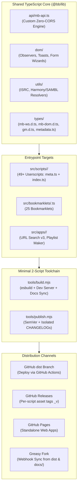

# TypeScript Monorepo & Modern Build Architecture (`brainz-box` / `bb`)

> **Source Knowledge**: Synthesized from architectural research and execution across previous conversations:
> - `cffb758c-4f48-46e9-8320-69a010b40384` (*Managing Script Repositories And Ideas*)
> - `73faf1de-65b2-4af2-81a1-44bc964ffd98` (*Deprecate ISRC Hunt Scripts*)
> - `6d419065-0b68-4b89-afea-af8e7f81bcc4` (*TypeScript Modernization Plan Roadmap*)
> - `b0ae1e2a-93ae-48f0-af41-de915ba99010` (*Brainz-Box Monorepo Implementation Plan*)
>
> **Active Implementation**: Repository `chaban-mb/brainz-box` at `d:\Documents\git\brainz-box` (State: `STATE.toon`).

---

## 1. Executive Summary & Vision

As a userscript collection scales beyond 50+ scripts, maintaining flat standalone JavaScript files creates compounding friction:
1. **Pervasive Code Duplication**: Helper functions (MusicBrainz API calls, Knockout observable bindings, toast notifications, DOM observers, ISRC parsers, URL codecs) are copied across dozens of scripts or inlined via fragile regexes.
2. **Brittle Build & Distribution Tooling**: Legacy sync mechanisms (e.g. `tools/build_dist.py` replaying substantive commits onto an orphan `dist` branch) suffer from git DAG range bugs (`matched_main`), commit message flooding on Greasy Fork, and accidental downgrades on `dist`.
3. **Fragile Unit Testing**: Tests relied on regex string splicing to strip IIFE footers (`code.replace(/\n\s*\}\)\(\);\s*$/, ...)`), preventing native ESM imports and type-safe mocks.

### The Solution: `brainz-box` (`bb`)
A unified, strictly-typed monorepo uniting **Userscripts**, **Bookmarklets**, **Standalone Web Applications** (GitHub Pages), and a **Shared TypeScript API Engine** under one roof.



---

## 2. Architectural Blueprint & Directory Layout

### Monorepo Structure (`d:\Documents\git\brainz-box`)
```
brainz-box/
├── .brain/                         # Architectural specs & design notes
├── .github/
│   └── workflows/
│       ├── ci.yml                  # Typecheck (tsc), Vitest unit tests, esbuild
│       ├── deploy-dist.yml         # Syncs built dist/ to orphan 'dist' branch on push to main
│       ├── pages.yml               # Deploys dist/apps to GitHub Pages
│       └── release.yml             # Tag-triggered (<slug>_v<ver>) GitHub Releases
├── dist/                           # Compiled production artifacts (gitignored on main)
│   ├── userscripts/                # Unminified IIFE standalone .user.js files
│   ├── bookmarklets/               # Minified javascript: IIFE .js files
│   └── apps/                       # Static web apps (HTML/CSS/bundled JS)
├── docs/
│   ├── descriptions/               # Synced markdown descriptions for Greasy Fork
│   ├── USERSCRIPTS.md              # Auto-generated userscripts catalog table
│   └── BOOKMARKLETS.md             # Auto-generated bookmarklet installation table
├── src/
│   ├── lib/                        # Shared TypeScript Core (@bb/lib/*)
│   │   ├── api/
│   │   │   └── mb-api.ts           # Typed MusicBrainz API client (GM.xmlHttpRequest + fetch)
│   │   ├── dom/                    # DOM observers, toast notifications, UI helpers
│   │   ├── utils/
│   │   │   └── resolvers.ts        # Harmony, SAMBL, ISRC URL matchers & codecs
│   │   └── types/
│   │       ├── gm.d.ts             # Violentmonkey / Tampermonkey ambient types
│   │       ├── mb-dom.d.ts         # window.MB, Knockout observable definitions
│   │       ├── mb-ws.d.ts          # MusicBrainz WS/2 response types (dev reference)
│   │       └── metadata.ts         # UserscriptMetadata interface for meta.ts
│   ├── scripts/                    # Userscripts (@bb/scripts/*)
│   │   └── <slug>/
│   │       ├── meta.ts             # Strongly typed userscript header metadata
│   │       ├── index.ts            # Script logic entry point
│   │       ├── CHANGELOG.md        # Isolated per-script release notes
│   │       └── README.md           # Documentation source for docs/descriptions/
│   ├── bookmarklets/               # Bookmarklets (@bb/bookmarklets/*)
│   │   └── <slug>.ts
│   └── apps/                       # Standalone Web Applications (@bb/apps/*)
│       ├── url-search/
│       └── playlist-maker/
├── tests/
│   ├── fixtures/                   # Static API responses & HTML dumps
│   └── unit/                       # Vitest unit test suites
├── tools/
│   ├── build.mjs                   # Fast esbuild compiler, dev server, and doc generator
│   └── publish.mjs                 # Release publisher, SemVer bumper, changelog updater
├── package.json                    # "type": "module", esbuild, vitest, typescript
├── STATE.toon                      # Token-Oriented Object Notation state descriptor
├── tsconfig.json                   # Strict TypeScript compiler options & path aliases
└── vitest.config.ts                # Vitest configuration matching tsconfig aliases
```

### TypeScript Path Aliases (`tsconfig.json`)
```json
{
  "compilerOptions": {
    "target": "ESNext",
    "module": "ESNext",
    "moduleResolution": "Bundler",
    "strict": true,
    "allowJs": true,
    "checkJs": false,
    "noEmit": true,
    "esModuleInterop": true,
    "skipLibCheck": true,
    "types": ["@violentmonkey/types"],
    "forceConsistentCasingInFileNames": true,
    "baseUrl": ".",
    "paths": {
      "@bb/lib/*": ["src/lib/*"],
      "@bb/scripts/*": ["src/scripts/*"],
      "@bb/bookmarklets/*": ["src/bookmarklets/*"],
      "@bb/apps/*": ["src/apps/*"]
    }
  },
  "include": ["src/**/*", "tests/**/*", "tools/**/*"],
  "exclude": ["node_modules", "dist"]
}
```

> [!WARNING]
> **Path Resolution Trap (TS2307)**: In `tsconfig.json`, the `"include"` array must explicitly include `"src/**/*"`. If only `"src/lib/**/*"` is listed, VS Code's language server will fail to resolve `@bb/lib/*` from `src/scripts/<slug>/meta.ts` with error `TS2307: Cannot find module '@bb/lib/types/metadata'`.

---

## 3. Greasy Fork Compliance & Code Safety Rules

Greasy Fork enforces strict security guidelines to protect end-users:

### A. The Human-Readable Code Requirement (`minify: false`)
- **Policy**: Greasy Fork prohibits obfuscated, packed, or heavily minified code. Moderators and automated scanners must be able to inspect every statement.
- **Bundler Implementation**: In `esbuild`, set `minify: false`. `esbuild` bundles imported modules into a single file while preserving clear variable names, comments, and line breaks.

### B. Inlining Local Code vs. External Dependencies (`@require`)
- **Inlining Local Modules**: Bundling repository modules (`import { ... } from '@bb/lib/...'`) inline into the compiled `.user.js` file is **100% compliant** with Greasy Fork rules when unminified.
- **Third-Party Libraries**: External dependencies must either:
  1. Be referenced via `@require` strictly from whitelisted CDNs (`cdn.jsdelivr.net`, `unpkg.com`, `cdnjs.cloudflare.com`).
  2. Be bundled inline unminified.

### C. Zero Runtime Daemon Invariant
Production `.user.js` files must be completely self-contained. Normal end-users must never need a local server, Node process, or background service running.

---

## 4. API Client Strategy: Zero Runtime Inflation

### Custom Engine vs. External Client (`@Borewit/musicbrainz-api`)
When evaluating whether to replace our custom `lib/MusicBrainzAPI.js` with `@Borewit/musicbrainz-api`, the following architectural decision was established:

1. **Retain Custom Engine (`src/lib/api/mb-api.ts`)**:
   - Preserves `window.location.origin` dynamic detection (zero CORS within MusicBrainz).
   - Preserves `GM.xmlHttpRequest` transport for cross-origin requests on third-party sites (Spotify, Deezer, Volumo, YouTube).
   - Retains in-memory request caching (`cache` Map), 404 caching, URL batching (`lookupUrl` in chunks of 100), and rate-limiting queue.
   - Dual transport: seamlessly falls back to standard `fetch` when running in web applications (`src/apps/`) or Node test environments.
2. **Type Reference Only**:
   - `@Borewit/musicbrainz-api` type declarations are used **strictly as dev-time ambient reference interfaces** (`src/lib/types/mb-ws.d.ts`).
   - This avoids adding external bundle overhead or third-party runtime fetch layers while achieving 100% strict TypeScript completions and type checking for MB WS/2 payloads.

---

## 5. Dynamic Metadata Header System (`meta.ts`)

Instead of hardcoded comment banners in script headers, each userscript exports a structured TypeScript object:

```typescript
// src/scripts/batch-delete-entities/meta.ts
import type { UserscriptMetadata } from '@bb/lib/types/metadata';

export const meta: UserscriptMetadata = {
  name: 'MusicBrainz: Batch Delete Entities',
  namespace: 'https://musicbrainz.org/user/chaban',
  version: '1.0.0',
  description: 'Batch deletes entities like releases or recordings.',
  author: 'chaban',
  license: 'MIT',
  match: [
    '*://*.musicbrainz.org/artist*',
    '*://*.musicbrainz.org/release*',
  ],
  exclude: [
    '*://*.musicbrainz.org/*/create*',
  ],
  grant: ['none'],
};
```

### Dynamic Header Transformations in `tools/build.mjs`:
The build script generates a 5-tier aligned `// ==UserScript==` block:
1. **Identity & Core Info**: `@name`, `@namespace`, `@version`
2. **Metadata, Tags & Attribution**: `@description`, `@tag`, `@author`, `@license`
3. **Scope, Media & Dependencies**: `@match`, `@include`, `@exclude`, `@connect`, `@require`, `@resource`, `@icon`
4. **Permissions & Execution**: `@grant`, `@run-at`, `@inject-into`
5. **Distribution Infrastructure**: `@homepageURL`, `@supportURL`, `@updateURL`, `@downloadURL`

#### Development vs. Production Transformations:
| Field | Production Build (`npm run build`) | Development Server (`npm run dev`) |
| :--- | :--- | :--- |
| `@name` | `MusicBrainz: Batch Delete Entities` | `MusicBrainz: Batch Delete Entities (DEV)` |
| `@version` | `1.0.0` (from `meta.ts`) | Timestamp: `YYYY.M.D.HHMMSS` (updates on every save) |
| `@updateURL` | Raw GitHub URL on `dist` branch | `http://127.0.0.1:8765/userscripts/<slug>.user.js` |
| `@downloadURL` | Raw GitHub URL on `dist` branch | `http://127.0.0.1:8765/userscripts/<slug>.user.js` |

---

## 6. Local Development Loop & Extension Synchronization

### Option 1: Local HTTP Dev Server + VM "Check for updates" (Preferred)
1. Run `npm run dev` (`tools/build.mjs --watch`). Dev server listens at `http://127.0.0.1:8765/`.
2. Open `http://127.0.0.1:8765/userscripts/<slug>.user.js` once in Chromium and click **Install**. Close the tab.
3. On saving any `.ts` file, `esbuild` rebuilds and bumps the timestamp version.
4. In Violentmonkey, click **Check for updates** (or wait for auto-check); Violentmonkey immediately installs the updated code into the browser without copy-pasting.

### Option 2: Violentmonkey Native File Tracking
1. Open the local built script in Violentmonkey installer.
2. Click **`✚ Track external edits`** and check `[x] Reload tab`.
3. Keep the editor/installer tab open; Violentmonkey polls ETags and automatically reloads target tabs on save.

### Option 3: Violentmonkey MCP Bridge (`tools/dev_server.js`)
1. For live AI agent interaction, connect the Violentmonkey MCP WebSocket bridge (`ws://127.0.0.1:8080/ws`).
2. Pushes compiled scripts directly via `scripts_write` and reloads tabs automatically.

---

## 7. Dual-Output Taxonomy: Suites vs. Standalones

To prevent script bloat while maintaining minimal installs for power users, scripts are categorized into 5 functional suites and 1 standalone utility group:

| Cluster / Suite | Member Scripts | Candidate Shared Modules |
| :--- | :--- | :--- |
| **1. ISRC & Fingerprinting Suite** | • `add-spotify-deezer-isrc-release`<br>• `add-spotify-soundexchange-isrc`<br>• `auto-login-isrc-importers`<br>• `search-isrc-release-editor`<br>• `isrc-hunt-*` (legacy/rewrite) | • ISRC validation & normalization<br>• Harmony URL codec<br>• Streaming service URL matchers |
| **2. Edit Reviewer Suite** | • `align-columns-merge-edits`<br>• `mass-merge-recordings`<br>• `warn-length-diff-recording-merge`<br>• `editor-subscription-manager`<br>• `subscriber-spam-filter` | • `EditReviewHeuristics.ts`<br>• Edit note scrapers<br>• Local DuckDB / API cache |
| **3. Release Editor Power Suite** | • `guesscase-improver`<br>• `guess-release-language-script`<br>• `resizable-secondary-types`<br>• `hotkeys-selected-entities`<br>• `relationship-editor-batch-remove`<br>• `release-day-of-week`<br>• `highlight-identical-barcodes` | • Knockout observable adapters<br>• Keyboard shortcut router<br>• Language & script heuristics |
| **4. Cover Art & Media Suite** | • `artwork-uploader-turbo`<br>• `artwork-uploader-thumbnails`<br>• `batch-remove-cover-art`<br>• `auto-show-acoustids`<br>• `compare-acoustids-easier` | • CAA upload pipeline<br>• AcoustID API client<br>• Image dimension inspector |
| **5. Third-Party Importers** | • `spotify-importer`<br>• `spotify-release-list-checker`<br>• `soundcloud-inspector`<br>• `deezer-importer`<br>• `beatport-importer`<br>• `volumo-importer`<br>• `youtube-importer` | • External platform DOM scrapers<br>• MB release seeding generator |
| **6. Standalone Utilities** | • `bandcamp-show-more-dates`<br>• `checkboxmate-modernized`<br>• `click-buttons-across-tabs`<br>• `discourse-disable-touch`<br>• `dom-mutation-debugger`<br>• `isbn-barcode-generator` | • Isolated DOM utilities |

**Dual-Output Capability**: The build system can compile both combined suites (`dist/*.suite.user.js` with module toggle dialogs) and tree-shaken single micro-scripts (`dist/userscripts/<slug>.user.js`) from identical source files.

---

## 8. Release Automation & GitHub Actions Pipeline

### Eliminating the Legacy `build_dist.py` DAG Bug
In the legacy repository, `tools/build_dist.py` synced an orphan `dist` branch by replaying commits from `main`. A bug in `find_commits_to_sync` (using git 2-dot commit ranges when branches diverged) replayed months of historical commits, flooding Greasy Fork version pages and accidentally downgrading releases (e.g. `MusicBrainz Guess Case Improver`).

### Modern GitHub Actions Pipeline:
1. **`ci.yml`**: On push/PR to `main` and `dev`:
   - Runs `npm run typecheck` (`tsc --noEmit`).
   - Runs `npm test` (`vitest run`).
   - Runs `npm run build` (`tools/build.mjs`).
2. **`deploy-dist.yml`**: On push to `main`:
   - Builds all targets into `./dist`.
   - Uses `peaceiris/actions-gh-pages@v4` to atomically deploy `./dist` directly to the orphan `dist` branch with commit message:
     `"deploy: sync built userscripts, bookmarklets, and web apps to dist [skip ci]"`
   - **Zero DAG calculation bugs. Zero historical commit replaying.**
3. **`release.yml`**: Tag-triggered (`<slug>_v<version>`):
   - Parses slug and version from tag name.
   - Extracts release notes from `src/scripts/<slug>/CHANGELOG.md` between `## [<version>]` headers.
   - Builds the specific script bundle.
   - Creates an atomic GitHub Release attaching `<slug>.user.js`.
4. **`pages.yml`**: Deploys `dist/apps/` to GitHub Pages (`chaban-mb.github.io/brainz-box/`).

---

## 9. Monorepo Release Tool (`tools/publish.mjs`)

To prevent root-level changelog noise in a monorepo with 50+ scripts:
- **Isolated `CHANGELOG.md`**: Each script directory (`src/scripts/<slug>/CHANGELOG.md`) tracks its own release history.
- **Selective Tagging**: `node tools/publish.mjs <slug> [major|minor|patch] --note "..."`
  - Updates version in `src/scripts/<slug>/meta.ts`.
  - Prepends dated `## [X.Y.Z] - YYYY-MM-DD` entry to `src/scripts/<slug>/CHANGELOG.md`.
  - Creates scoped git commit: `chore(<slug>): release vX.Y.Z`.
  - Creates git tag: `<slug>_vX.Y.Z`.
  - Pushing the tag triggers `release.yml` on GitHub Actions.

---

## 10. Key Traps, Invariants & Lessons Learned

| Issue / Phenomenon | Root Cause | Modern Solution / Invariant |
| :--- | :--- | :--- |
| **Greasy Fork Code Rejection** | Minification/obfuscation violating Greasy Fork rules. | Set `minify: false` in `esbuild`; output clean, unminified IIFE bundles. |
| **DAG Range Replay Mess** | `tools/build_dist.py` replaying substantive commits on orphan branch. | Replaced by GitHub Actions `peaceiris/actions-gh-pages` deploying `./dist` directly. |
| **GitHub Linguist 89% JS Skew** | Retaining raw JS files inside TS monorepo. | Complete strict TypeScript conversion (`index.ts`); avoid raw JS stubs. |
| **VS Code TS2307 on Path Aliases** | `src/scripts/**/*` omitted from `tsconfig.json` `"include"` array. | Explicitly include `"src/**/*"` in `tsconfig.json`. |
| **VS Code Formatter Conflicts** | Multiple formatters (`oxc` vs `typescriptteam.native-preview`). | Set explicit default formatter in user or workspace settings. |
| **Bookmarklet Clutter (`.uri.txt`)** | Generating temporary URL-encoded URI text files. | Removed `.uri.txt` outputs; build clean `.js` bookmarklets with docs link table. |
| **Refactor-First Parity Rule** | Mixing architectural migrations with feature changes or bugfixes. | Strict parity invariant: 100% logic parity before adding new features. |
| **Zero Daemon Invariant** | Depending on background servers for daily script use. | Production `.user.js` files must be 100% self-contained standalone scripts. |
